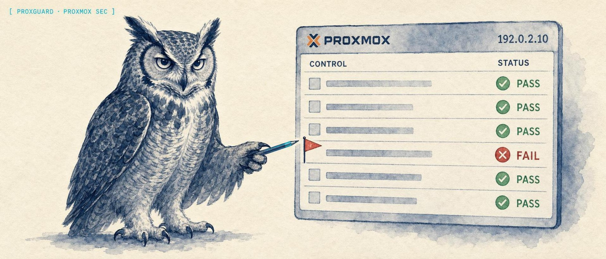
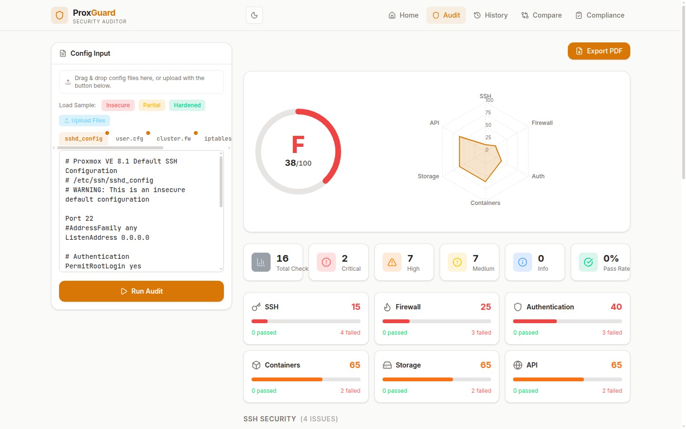

<p align="center">
  
</p>

<p align="center">
  <a href="https://lidless.dev"></a>
</p>

<h1 align="center">ProxGuard</h1>

<p align="center"><strong>Proxmox VE security auditor with CIS Benchmark-backed scoring and auto-generated remediation scripts.</strong></p>

<p align="center"><a href="https://lidless.dev/proxguard"><strong>Website</strong></a> &middot; <a href="#what-it-does">What it does</a> &middot; <a href="#install">Install</a></p>

<p align="center">
  
  
  
</p>

## What it does

ProxGuard parses Proxmox configuration you paste or drop into the browser (sshd_config, user.cfg, cluster.fw, iptables output, LXC container configs, storage.cfg, tfa.json and pveproxy) and grades your security posture across six categories. Every rule traces back to a CIS Benchmark or a Proxmox-specific check. Failed checks include remediation steps and copy-paste shell commands to fix the issue.



---

## Features

- **Security Audit Engine** - Paste or drop config files, get a letter grade with detailed findings
- **CIS Benchmark Rules** - 17 rules in 6 categories, mapped to CIS Debian 11 and Proxmox-specific checks
- **Scoped Scoring** - Only categories you supplied input for are scored, so a missing file never counts as a pass or a fail
- **Remediation Scripts** - Every failed check includes copy-paste shell commands, and the Script Generator combines them into one downloadable `.sh` with a `--dry-run` mode and per-fix confirmation
- **File Drop** - Drop config files onto the input panel. ProxGuard detects the file type by name or content and asks when it can't tell
- **Dashboard** - Last audit, score trend over recent audits and quick links to the demo configs
- **History** - The last 50 audits are kept in your browser. Delete entries or pick two to compare
- **Comparison** - Score change per category and which findings flipped between two audits
- **Compliance View** - Pass/fail status of every benchmark-mapped check in the current audit
- **PDF Export** - Save the results panel as a multi-page PDF report
- **Offline-First** - All processing happens in the browser, no data leaves your machine

---

## Install

```bash
git clone https://github.com/lidless-labs/proxguard.git
cd proxguard
npm install
npm run dev
```

Open **http://localhost:5173** (Vite's default port. `vite.config.ts` does not set one).

---

## Development

Requires Node 22 or newer.

```bash
npm ci              # install exact dependencies
npm run lint        # ESLint
npm run typecheck   # TypeScript project check, no output
npm test            # compile and run every tests/*.test.ts with node:test
npm run check:docs  # fail if README or docs/ name a src/ path that does not exist
npm run build       # production build
```

`npm test` compiles into `.test-dist/` (gitignored) and picks up any new `tests/*.test.ts` file on its own. CI runs the same six steps on every pull request and on pushes to `main`.

---

## Running an audit

1. Open the **Audit** page
2. Paste or drop any of these into their tabs:
   - `/etc/ssh/sshd_config` (SSH hardening)
   - `/etc/pve/user.cfg` (users, groups, ACLs and API tokens)
   - `/etc/pve/firewall/cluster.fw` (cluster firewall options and rules)
   - `iptables-save` or `iptables -L -n -v` output (host firewall policy)
   - `/etc/pve/lxc/<vmid>.conf` (one or more container configs)
   - `/etc/pve/storage.cfg` (NFS and CIFS mounts)
   - Output of `pveum user tfa list --output-format json` on the **tfa.json** tab (second-factor metadata without secrets). Supply it alongside `user.cfg` to evaluate 2FA enrollment
   - `/etc/default/pveproxy` (web UI and API access restrictions on port 8006)
3. Run the audit. ProxGuard parses each file you supplied, runs the rules whose required inputs are present, and generates your report
4. Click any finding for evidence, the CIS reference and remediation commands

No data is sent anywhere. The entire audit runs client-side in your browser.

---

## How the scoring works

ProxGuard has 17 security rules across 6 categories. Each category has a weight reflecting its risk to a Proxmox environment:

| Category | Weight | Source file | What It Checks |
|----------|--------|-------------|----------------|
| **SSH** | 25% | sshd_config | Root login, password auth, default port, max auth tries |
| **Firewall** | 25% | cluster.fw, iptables | Cluster firewall enabled, default INPUT policy, rule existence |
| **Authentication** | 20% | user.cfg, tfa.json | 2FA enrollment, root API tokens, Administrator role grants |
| **Container** | 15% | lxc.conf | Privileged containers, nesting enabled |
| **Storage** | 10% | storage.cfg | NFS root_squash, CIFS permissions |
| **API** | 5% | user.cfg, pveproxy | Admin token privileges, token expiration, pveproxy access restriction |

SSH and Firewall are weighted heaviest because they're the most common attack surface on internet-facing Proxmox hosts. Rules requiring `user.cfg` or `pveproxy` run only when that input is present. The 2FA check shows **Not evaluated** unless both usable TFA metadata and a user list are available, and skipped checks cost no points. A category is scored only when at least one check was evaluated. The overall score is the weighted average of those categories. TFA metadata alone produces skipped evidence, no scored categories and an overall score of 0.

### Deductions

Each category starts at 100. Each failed rule deducts from its category score based on severity, with a floor of 0:

| Severity | Deduction | Example |
|----------|-----------|---------|
| **Critical** | -40 | Root SSH with password auth enabled |
| **High** | -25 | Users without two-factor authentication |
| **Medium** | -10 | SSH on default port 22 |
| **Info** | -5 | Defined in the scoring engine. No current rule uses it |

The overall score maps to a grade:

| Grade | Score | Meaning |
|-------|-------|---------|
| **A** | 90+ | Hardened configuration |
| **B** | 80-89 | Good with minor gaps |
| **C** | 70-79 | Needs attention |
| **D** | 60-69 | Significant risks |
| **F** | <60 | Critical vulnerabilities present |

### CIS benchmark mapping

Every rule references its source standard:

| Rule | Severity | CIS Benchmark |
|------|----------|---------------|
| Root SSH with Password Authentication | Critical | CIS Debian 11 - 5.2.10 |
| Cluster Firewall Not Enabled | Critical | CIS Debian 11 - 3.5.1.1 |
| Password Authentication Enabled Globally | High | CIS Debian 11 - 5.2.12 |
| Default INPUT Policy is ACCEPT | High | CIS Debian 11 - 3.5.2.4 |
| Users Without Two-Factor Authentication | High | CIS Debian 11 - 5.4.2 |
| Root Account Has API Tokens | High | CIS Debian 11 - 5.4.1 |
| Privileged LXC Containers Detected | High | PVE-CT-001 |
| NFS Mount with no_root_squash | High | PVE-STOR-001 |
| API Tokens with Full Admin Privileges | High | PVE-API-001 |
| SSH Running on Default Port 22 | Medium | CIS Debian 11 - 5.2.15 |
| MaxAuthTries Too High | Medium | CIS Debian 11 - 5.2.7 |
| No Firewall Rules Defined | Medium | CIS Debian 11 - 3.5.2.5 |
| Users with Administrator Role | Medium | CIS Debian 11 - 5.3.1 |
| Container Nesting Enabled | Medium | PVE-CT-002 |
| CIFS Mount with Broad Permissions | Medium | PVE-STOR-002 |
| API Tokens Without Expiration | Medium | PVE-API-002 |
| Web UI and API Reachable From Any Address | Medium | PVE-API-003 |

PVE-prefixed benchmarks are Proxmox-specific rules where no direct CIS mapping exists.

---

## Tech stack

| Layer | Technology | Purpose |
|-------|-----------|---------|
| **Framework** | React 19 | Interactive UI |
| **Routing** | React Router 7 | Page routes |
| **Language** | TypeScript 5 | Type safety |
| **Styling** | Tailwind CSS 4 | Utility-first CSS via `@tailwindcss/vite` |
| **Animation** | Framer Motion 11 | Transitions and animated gauges |
| **Charts** | Recharts 2 | Score trend and category radar charts |
| **State** | Zustand 5 | Audit state, persisted history |
| **PDF** | jsPDF + html2canvas | PDF report export |
| **Bundler** | Vite 7 | Dev server and build |
| **Icons** | Lucide React | Consistent icon set |

---

## Project structure

```text
proxguard/
├── src/
│   ├── App.tsx                   # Layout, navigation, routes, transparency modal
│   ├── main.tsx                  # Entry point, router setup
│   ├── index.css                 # Tailwind entry and global styles
│   ├── components/
│   │   ├── DashboardPage.tsx     # Landing page: last audit, score trend
│   │   ├── AuditPage.tsx         # Config input, file drop and results
│   │   ├── HistoryPage.tsx       # Past audits from localStorage
│   │   ├── ComparisonPage.tsx    # Side-by-side diff of two audits
│   │   ├── CompliancePage.tsx    # CIS-mapped pass/fail view
│   │   ├── ScoreSummary.tsx      # Finding counts by severity
│   │   ├── GradeBadge.tsx        # Letter grade display
│   │   ├── AnimatedGauge.tsx     # Score gauge animation
│   │   ├── CategoryCard.tsx      # Per-category score card
│   │   ├── CategoryRadar.tsx     # Radar chart of categories
│   │   ├── FindingCard.tsx       # Individual finding display
│   │   ├── SeverityBadge.tsx     # Severity label
│   │   ├── ScriptGenerator.tsx   # Combined remediation script
│   │   └── ExportButton.tsx      # PDF report export
│   ├── parsers/
│   │   ├── index.ts              # parseAllConfigs orchestrator
│   │   ├── sshd.ts               # sshd_config
│   │   ├── userCfg.ts            # user.cfg (users, ACLs, groups, tokens)
│   │   ├── clusterFw.ts          # cluster.fw
│   │   ├── iptables.ts           # iptables-save and iptables -L output
│   │   ├── lxc.ts                # LXC container configs
│   │   ├── storage.ts            # storage.cfg
│   │   ├── tfa.ts                # tfa.json metadata
│   │   └── pveproxy.ts           # pveproxy access controls
│   ├── rules/
│   │   ├── ssh.ts                # SSH hardening rules (4)
│   │   ├── firewall.ts           # Firewall rules (3)
│   │   ├── auth.ts               # Authentication rules (3)
│   │   ├── container.ts          # Container security rules (2)
│   │   ├── storage.ts            # Storage mount rules (2)
│   │   ├── api.ts                # API token and pveproxy rules (3)
│   │   └── index.ts              # allRules registry
│   ├── store/
│   │   └── auditStore.ts         # Zustand store, persisted history
│   ├── utils/
│   │   └── scoring.ts            # Weighted scoring engine
│   ├── data/
│   │   ├── index.ts              # Demo config loader
│   │   ├── insecure.ts           # Demo: insecure config (F grade)
│   │   ├── partial.ts            # Demo: partially hardened (C grade)
│   │   └── hardened.ts           # Demo: hardened config (A grade)
│   ├── types/
│   │   └── index.ts              # TypeScript interfaces
│   └── variants/
│       ├── themes.ts             # Analyst theme definition
│       └── ThemeProvider.tsx     # Theme context
├── tests/                        # node:test regression tests and fixtures
├── scripts/
│   └── check-docs.mjs            # Docs path check run in CI
├── docs/                         # Architecture and configuration notes
├── index.html
├── package.json
├── vite.config.ts
└── vercel.json
```

---

## Demo configs

ProxGuard includes three demo configurations so you can see the audit engine without a Proxmox cluster:

- **Insecure** - Root SSH with password, firewall disabled, no 2FA. Fails all 17 rules and grades F.
- **Partial** - Some hardening but gaps. Grades C.
- **Hardened** - Best practices applied. Passes every rule and grades A.

---

## License

MIT - see [LICENSE](LICENSE) for details.

---

<p align="center"><a href="https://lidless.dev">Part of <strong>Lidless Labs</strong></a> &middot; the eye does not close</p>

<p align="center"><sub><strong>Homelab:</strong> <a href="https://github.com/lidless-labs/proxmox-mcp">proxmox-mcp</a> &middot; <a href="https://github.com/lidless-labs/adguardctrl">adguardctrl</a> &middot; <a href="https://github.com/lidless-labs/immichctrl">immichctrl</a> &middot; <a href="https://github.com/lidless-labs/jellyctrl">jellyctrl</a></sub></p>

<p align="center"><sub><a href="https://lidless.dev">All tools</a> &middot; <a href="https://github.com/lidless-labs">Lidless Labs on GitHub</a></sub></p>
